  

# 🛡️ Awesome Generative AI Security Analyst 🤖

> 🚀 **A curated, comprehensive directory of elite Generative AI Security Analyst platforms, autonomous SOC agents, agentic threat detection copilots, and open-source SecOps intelligence engines.**  
> 🌟 *Star this repository to stay ahead in autonomous defensive cyber operations!* 🌟

---

## 📑 Table of Contents

- [🌐 Sector Overview & Market Dynamics](#-sector-overview--market-dynamics)
- [🟦 Enterprise SaaS / Hosted Platforms](#-enterprise-saas--hosted-platforms)
- [🟩 Open-Source Software](#-open-source-software)
- [📊 Feature Comparison Matrix](#-feature-comparison-matrix)
- [🔍 Key Evaluation Criteria for AI Security Analysts](#-key-evaluation-criteria-for-ai-security-analysts)
- [💖 Support & Sponsorship](#-support--sponsorship)
- [⭐ Star History](#-star-history)
- [🤝 Contributing](#-contributing)
- [📄 License](#-license)

---

## 🌐 Sector Overview & Market Dynamics

The global **Generative AI in Cybersecurity and AI SOC market** is estimated at **$15.5B–$19.4B in 2024–2025** and is projected to expand aggressively past **$47.0B–$82.5B by 2030–2031** at a compound annual growth rate (CAGR) exceeding **22%–28%**. 

Currently, the industry exhibits a **moderately fragmented and rapidly bifurcating market structure**: established multi-billion dollar platform incumbents (Microsoft, Palo Alto Networks, CrowdStrike, Google SecOps) dominate end-to-end enterprise platformization through bundled copilots, while an aggressive tier of specialized AI-native startups and hyper-innovative open-source LLM agent frameworks (leveraging MCP, Ollama, and local reasoning models) capture surging demand from privacy-conscious SOCs, MSPs, and sovereign cloud environments seeking to avoid vendor lock-in and steep hourly SCU compute pricing.

---

## 🟦 Enterprise SaaS / Hosted Platforms

Below is the structured overview of commercial, enterprise-grade Generative AI security analyst platforms, sorted in descending order by **company market capitalization / enterprise valuation**.

| Platform | Provider / Parent | Company Size (Market Cap / Valuation) | Starting Pricing (Specific Tier) | Free Tier / Free Trial Limits | Key AI Analyst Capabilities & Focus |
|:---|:---|:---:|:---|:---|:---|
| **Microsoft Security Copilot** 🛡️ | Microsoft | **~$3,100B** (Market Cap) | **$4.00 / provisioned SCU / hour** (min 1 SCU continuous baseline = ~$2,880–$2,976/month) + $6.00/hour overage; includes 400 SCU/mo per 1k E5/E7 seats | **No free tier**; trials managed via structured 30-day proof-of-concept credits via Azure Enterprise agreements | Embedded across Defender XDR, Sentinel SIEM, Entra ID, and Purview; automated alert summarization, scripted KQL generation, and incident triage |
| **Google Cloud Security AI Workbench** 🧠 | Alphabet / Google Cloud | **~$2,100B** (Market Cap) | **$1.95 – $4.60 per GB/year data ingestion** (Google SecOps Standard to Enterprise Plus; AI Security Tokens consumption meter) | **$300 free billing credit across 90-day trial** for Google Cloud / Vertex AI services | Powered by Sec-PaLM 2 / Gemini models; native Threat Hunt Agent, Mandiant threat attribution, and YARA-L detection rule engineering |
| **Palo Alto Cortex Agi / XSIAM** ⚡ | Palo Alto Networks | **~$110B** (Market Cap) | **$180 – $240 per endpoint/year** or standard data ingestion tier starting ~$50,000/year minimum contract commitment | **No public free tier**; vendor offers interactive guided demo and structured 30-day pilot POC for qualified enterprise SOCs | Autonomous SecOps engine built directly into Cortex XSIAM; automated alert grouping, causal attack chaining, and multi-vector playbooks |
| **CrowdStrike Charlotte AI** 🦅 | CrowdStrike | **~$75B** (Market Cap) | **$16.00 / endpoint / year add-on** (or bundled with Falcon Enterprise at $184.99/device/year list; includes starter monthly AI credits) | **15-day free trial** of Falcon Prevent/Pro platform with test telemetry; advanced Charlotte AI module requires sales trial unlock | Multi-domain agentic triage (>98% accuracy claims); autonomous context stitching across endpoint, identity, cloud, and network |
| **Splunk AI Assistant** 📊 | Cisco / Splunk | **~$28B** (Acquisition Valuation) | **Included at $0 additional software fee** for Splunk Enterprise / Cloud Platform customers (Splunk Cloud starts at ~$180/ingested GB/month) | **14-day free cloud trial** (Splunk Cloud Platform instance with 5 GB/day indexing quota) | Translates natural language into Search Processing Language (SPL); automated investigation playbooks within Splunk Enterprise Security |
| **Tenable ExposureAI** 🎯 | Tenable | **~$5.0B** (Market Cap) | **~$35,000 / year baseline contract** (Tenable One platform asset licensing based on IP/cloud asset blocks) | **30-day free trial** of Tenable Vulnerability Management (up to 64 scanned assets) | Integrated across Tenable One Exposure Management; natural language search for attack pathways, asset criticality, and remediation actions |
| **SentinelOne Purple AI** 🔮 | SentinelOne | **~$4.5B** (Market Cap) | **$179.99 / endpoint / year** (Singularity Complete tier) or $229.99/endpoint/year (Singularity Commercial) with Purple AI included | **30-day enterprise free evaluation** (up to 100 endpoints upon sales authorization) | Integrated into Singularity XDR; autonomous alert investigation, interactive threat hunting queries, and one-click mitigation playbooks |
| **Elastic AI Assistant** 🔎 | Elastic N.V. | **~$4.0B** (Market Cap) | **$184.00 / month baseline** (Elastic Cloud Enterprise tier; standard tiers start at $99/mo; BYO LLM token costs apply) | **14-day free trial** of Elastic Cloud Enterprise (includes full Kibana & Security features, 4 GB RAM / 120 GB storage instance) | Built natively into Elastic Security; alert triage, context enrichment, generative remediation commands, and customizable system prompts |
| **Wiz AI-SPM Assistant** ☁️ | Wiz | **~$12.0B** (Private Valuation) | **~$24,000 / year baseline starting contract** (essential package tier covering up to 100 cloud workloads) | **No public self-serve free tier**; interactive sandbox guided demo and 14-day assisted enterprise cloud POC available | Cloud-native risk prioritization, AI security posture management (AI-SPM), misconfiguration remediation, and attack path graph queries |
| **Recorded Future AI** 🌐 | Recorded Future (Mastercard) | **~$2.65B** (Acquisition Valuation) | **~$40,000 / year single-module starter tier** (Core Threat Intelligence package with annual ACV commitment) | **No self-serve free trial**; access limited to free Recorded Future Cyber Daily email summary; 14-day analyst POC for vetted security teams | Automated intelligence collection, dark-web chatter summarization, credential exposure analysis, and automated risk scoring |

---

## 🟩 Open-Source Software

Self-hosted, transparent, community-driven Generative AI security analyst platforms and autonomous SOC frameworks. Listed in **descending order by GitHub Stars_Count**.

### 1. [AiSOC](https://github.com/beenuar/AiSOC) 🌟
  
**Stack:** Python / MCP / Ollama | **License:** MIT | **Deployment:** 100% Self-Hosted  
An open-source AI Security Operations Center providing automated alert fusion, LLM-agent alert triage, and automated MITRE ATT&CK investigation. Features a replayable decision ledger tracking every reasoning step taken by the agent. Ships with a first-class Model Context Protocol (MCP) server for integration with Claude, Cursor, and Continue, running completely free of external cloud API dependencies.  
🎯 **Best For:** SOC teams needing a complete, transparent, locally deployable agentic SOC with strict auditability.

---

### 2. [Agentic SOC Platform](https://github.com/FunnyWolf/agentic-soc-platform) 🤖
  
**Stack:** Python / LangGraph / LangChain | **License:** Apache 2.0 | **Deployment:** Docker / Kubernetes  
A powerful, modular, agent-centric automated security operations platform designed for next-generation SOC environments. Integrates deep event telemetry pipelines, automated playbook execution, and multi-agent coordination frameworks to triage alerts, execute root cause analysis, and dispatch incident mitigation tasks.  
🎯 **Best For:** Engineering-heavy SOC teams wanting a customizable, graph-orchestrated multi-agent workflow.

---

### 3. [Vigil (DeepTempo)](https://github.com/Vigil-SOC/vigil) 🛡️
  
**Stack:** Python / LogLM / Markdown | **License:** Apache 2.0 | **Deployment:** Self-Hosted / On-Prem  
The leading open-source AI SOC built with an LLM-native architecture. Ships with 13 specialized AI security agents, 30+ vendor integrations, and 7,200+ detection rules spanning Sigma, Splunk, Elastic, and KQL formats. Includes four production-tested multi-agent workflows (incident response, investigation, threat hunting, and forensic analysis) executed against your own enterprise LLMs without vendor lock-in.  
🎯 **Best For:** Enterprise SOCs requiring transparent, playbook-driven multi-agent orchestration connected to custom LLMs.

---

### 4. [NVISO Cyber Security LLM Agents](https://github.com/NVISOsecurity/cyber-security-llm-agents) 🧪
  
**Stack:** Python / AutoGen / OpenAI / Ollama | **License:** Apache 2.0 | **Deployment:** CLI / Local  
A pioneering collection of modular LLM-powered security agents built to automate daily cybersecurity engineering, threat analysis, memory forensics, and incident coordination workflows. Features reusable agent definitions for red/blue teaming, alert enrichment, and automated reporting.  
🎯 **Best For:** Security researchers and defensive engineers looking for modular, plug-and-play LLM agent routines.

---

### 5. [Wazuh AI SOC Azure](https://github.com/Francis206/wazuh-ai-soc-azure) ☁️
  
**Stack:** Terraform / Azure AKS / Wazuh / Mistral / LoRA | **License:** MIT | **Deployment:** Azure Cloud / Kubernetes  
A complete production-ready infrastructure blueprint deploying an AI-augmented SOC on Azure. Combines Wazuh SIEM/XDR with fine-tuned local models (Mistral with LoRA adaptors) hosted on Azure Kubernetes Service (AKS), HIPAA/SOC2 compliance configurations, and real-time MLOps log triage pipelines.  
🎯 **Best For:** Cloud architects and security teams building an enterprise AI-augmented SOC on Microsoft Azure.

---

### 6. [AI_SOC (Multi-Agent SecOps)](https://github.com/zhadyz/AI_SOC) 🔬
  
**Stack:** Python / Foundation-Sec-8B / Wazuh / TheHive / RAG | **License:** MIT | **Deployment:** Self-Hosted  
An end-to-end open-source AI-augmented Security Operations Center integrating Wazuh SIEM telemetry, TheHive incident tracking, and multi-agent RAG reasoning. Powered by specialized cybersecurity fine-tuned models (`Foundation-Sec-8B`) for accurate alert correlation and false-positive reduction.  
🎯 **Best For:** Academic and enterprise labs testing fine-tuned domain LLMs on live SIEM telemetry.

---

### 7. [AI-SOC-Agent (Black Hat 2025)](https://github.com/M507/AI-SOC-Agent) 🎩
  
**Stack:** Python / FastMCP / ELK / DFIR IRIS | **License:** GPL-3.0 | **Deployment:** Self-Hosted / Docker  
The official codebase and presentation framework from Black Hat, featuring an AI SOC agent and MCP server for automated security investigation, alert triage, and incident response. Integrates seamlessly with ELK Stack, IRIS incident response management, and Open WebUI with human-in-the-loop review queues.  
🎯 **Best For:** Security teams seeking an MCP-compliant agent that connects LLMs to ELK and open-source DFIR platforms.

---

### 8. [NeuroPurple](https://github.com/JoasASantos/NeuroPurple) 🟣
  
**Stack:** Python / PyTorch / LLM Agents | **License:** MIT | **Deployment:** Docker / Local  
An autonomous SOC and Purple-Team engine that combines offensive security simulation with defensive detection analysis. Employs generative agents to simulate adversarial TTPs and simultaneously tests SOC detection rules and defensive triage pipelines.  
🎯 **Best For:** Purple teams aiming to automate continuous adversary emulation and autonomous SOC resilience validation.

---

### 9. [MANTIS](https://github.com/google/mantis) 🔍
  
**Stack:** Python / Claude Code / MCP | **License:** Apache 2.0 | **Deployment:** Local / CLI  
Google's modular, stack-agnostic security toolkit designed for AI coding agents to autonomously discover, reproduce, and generate verified patches for software vulnerabilities. Features automated hypothesis generation, exploit validation harnesses, and deterministic fix verification.  
🎯 **Best For:** AppSec teams, DevSecOps pipelines, and security analysts automating vulnerability remediation.

---

### 10. [Autonomous SOC Analyst](https://github.com/nicholasmagner/autonomous-soc-analyst) ⚡
  
**Stack:** Python / LangChain / Threat Intel APIs | **License:** MIT | **Deployment:** Local / Serverless  
An agentic AI security automation workflow specifically built for L1/L2 alert triage. Automatically extracts IOCs from raw alert feeds, queries reputation engines (VirusTotal, AlienVault OTX), reasons about risk score, and produces structured triage verdicts with proposed response actions.  
🎯 **Best For:** Lean blue teams wanting a fast, lightweight agent for automated IOC triage and reputation enrichment.

---

### 11. [LanG](https://github.com/lang-soc/lang) 🛡️
  
**Stack:** LangGraph / Python / Llama Guard | **License:** Apache 2.0 | **Deployment:** Multi-tenant / Local  
A governance-aware agentic AI platform for unified security operations. Key contributions include a Unified Incident Context Record (F1 = 87%), an LLM Rule Generator producing Snort/Suricata/YARA rules (96.2% acceptance rate), and a two-layer guardrail pipeline (regex + Llama Prompt Guard 2) achieving 98.1% F1 with zero false positives in experiments. Designed for MSSPs with full tenant isolation.  
🎯 **Best For:** Managed security service providers (MSSPs) requiring strict governance guardrails and multi-tenant isolation.

---

### 12. [TinySOC](https://github.com/tinysoc-org/tinysoc) 💻
  
**Stack:** Python / Gradio / llama.cpp | **License:** MIT | **Deployment:** 100% Local CPU  
A completely offline, local AI SOC analyst engineered for solo security operators, homelab defenders, and small MSPs. Runs entirely on local CPU via `llama.cpp` with zero telemetry transmission or cloud API dependencies. Features a 3-stage pipeline: deterministic baseline host profiling, token-level perplexity anomaly scoring, and ≤4B instruction model JSON triage.  
🎯 **Best For:** Air-gapped sites, privacy-sensitive environments, and solo practitioners on modest hardware.

---

## 📊 Feature Comparison Matrix

| Software / Project | License Model | Primary Technology Stack | Primary Deployment Method | Core Focus Area | Best Fit Persona |
|:---|:---:|:---|:---|:---|:---|
| **AiSOC** 🌟 | MIT | Python, MCP, Ollama | Local / Self-Hosted | Alert Fusion & MITRE Triage | Enterprise SecOps & Privacy-First SOCs |
| **Agentic SOC Platform** 🤖 | Apache 2.0 | Python, LangGraph | Docker / K8s | Graph-based Alert Orchestration | Advanced SecOps Engineers |
| **Vigil** 🛡️ | Apache 2.0 | Python, LogLM, Sigma | Self-Hosted / On-Prem | 13-Agent Full Lifecycle SOC | Scaled Enterprise SOC Teams |
| **NVISO Agents** 🧪 | Apache 2.0 | AutoGen, Python | CLI / Local | Modular Task Automation | DFIR Analysts & Threat Hunters |
| **Wazuh AI SOC Azure** ☁️ | MIT | Terraform, Wazuh, Mistral | Azure AKS | Cloud SIEM AI Augmentation | Cloud Security Architects |
| **AI_SOC** 🔬 | MIT | Python, Foundation-Sec-8B | Self-Hosted | Multi-Agent RAG on Wazuh | Security Researchers |
| **AI-SOC-Agent** 🎩 | GPL-3.0 | FastMCP, ELK, IRIS | Docker / Self-Hosted | MCP Incident Response Server | Blue Teams using Open WebUI & ELK |
| **NeuroPurple** 🟣 | MIT | Python, PyTorch | Local / Docker | Purple Team Adversary Emulation | Detection Engineers & Purple Teams |
| **Google MANTIS** 🔍 | Apache 2.0 | Python, Claude Code | CLI / CI-CD | Autonomous Vulnerability Patching | AppSec & DevSecOps Teams |
| **Autonomous SOC Analyst** ⚡ | MIT | Python, LangChain | Local / Cloud | Automated IOC Alert Triage | Lean SOCs & L1 Analysts |
| **LanG** 🛡️ | Apache 2.0 | LangGraph, Llama Guard | Multi-Tenant Cluster | Multi-Tenant MSSP Governance | MSSPs & Regulated Industries |
| **TinySOC** 💻 | MIT | Python, llama.cpp | 100% Local CPU | Privacy-preserving Offline Triage | Solo Defenders & Air-Gapped Sites |

---

## 🔍 Key Evaluation Criteria for AI Security Analysts

When choosing or deploying an AI Security Analyst solution, consider these key operational dimensions:

1. **🔒 Data Privacy & Model Boundary:** Does telemetry or sensitive PII leave your infrastructure, or can models run inside air-gapped perimeters via Ollama/vLLM?
2. **🔄 Human-in-the-Loop (HITL) Controls:** Does the agent act autonomously on critical infrastructure, or does it enforce approval gates before isolating endpoints or modifying firewall rules?
3. **🔌 Standardized Agent Protocols (MCP):** Does the tool utilize open standards like Anthropic's **Model Context Protocol (MCP)** to interact seamlessly across SIEM, SOAR, EDR, and ticketing platforms?
4. **🎯 Hallucination Prevention & Grounding:** Are investigation summaries grounded in deterministic evidence trees, STIX threat intelligence, and MITRE ATT&CK taxonomy?
5. **💰 Total Cost of Ownership (TCO):** Compare expensive hourly compute units (e.g., Microsoft SCUs at $4/hr continuously) against predictable self-hosted infrastructure.

## 💖 Support & Sponsorship

Thank you so much for exploring and using **Awesome Generative AI Security Analyst**! 🛡️✨

If this project brought value to your security workflow, helped you select the right AI SOC tools, or saved you research hours:
- ⭐ **Star** this repository to show your appreciation and boost its visibility!
- 🍴 **Fork** and contribute your favorite SecOps agents, tools, and benchmarks.
- 📢 **Share** it with your fellow defenders, blue teamers, and security engineers.
- ☕ **Buy me a coffee / Sponsor:** If you'd like to back ongoing open-source curation and research, consider supporting via the [GitHub Sponsor Dashboard](https://github.com/sponsors/ishandutta2007). Your support is deeply appreciated!

---

## 📈 Star History

---

## 🤝 Contributing

Contributions, new tool recommendations, and benchmarks are warmly welcomed! 

1. 🍴 Fork this repository.
2. 🌿 Create your feature branch (`git checkout -b feature/awesome-tool`).
3. 📝 Add your tool to the table/list following the formatting standards (ensure correct Stars_Badges and links).
4. 💾 Commit your changes (`git commit -m 'Add ToolName to awesome-list'`).
5. 🚀 Push to the branch (`git push origin feature/awesome-tool`).
6. 📬 Open a Pull Request.

---

## 📄 License

This compilation is licensed under the [Creative Commons Zero v1.0 Universal (CC0 1.0)](LICENSE) - Public Domain Dedication.  
All third-party product names, logos, and brands referenced are property of their respective owners.

---

  <b>⭐ Found this resource helpful? Star the repository and share it with fellow defenders! ⭐</b>

